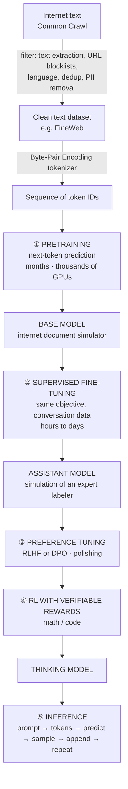

# 01 · The LLM Lifecycle: The Big Picture

> **Read this first.** Every other file in this repo zooms into one box of the diagram below.
> If you can redraw this diagram from memory and explain each box in two sentences, you can answer the interview opener *"Walk me through how ChatGPT is built."*

---

## The one-sentence summary (memorize this)

> **Pretraining gives knowledge, SFT gives behavior, preference tuning gives polish, RL gives reasoning, and the context window gives reliable facts at inference time.**

---

## The full pipeline



If the diagram above doesn't render, here is the same thing in plain text:

```
INTERNET TEXT
     │  filter: text extraction, URL blocklists, language, dedup, PII removal
     ▼
TOKENIZATION (Byte-Pair Encoding) → sequence of token IDs
     ▼
① PRETRAINING ─────────────── months · thousands of GPUs · very costly
     ▼
  BASE MODEL  ("internet document simulator")
     ▼
② SUPERVISED FINE-TUNING (SFT) ─────────── hours to days · cheap
     ▼
  ASSISTANT MODEL  ("simulation of an expert human labeler")
     ▼
③ PREFERENCE TUNING (RLHF or DPO) ───────── polishing
     ▼
④ RL WITH VERIFIABLE REWARDS ──────────── math / code
     ▼
  THINKING MODEL
     ▼
⑤ INFERENCE: prompt → tokens → predict → sample → append → repeat
```

---

## Stage by stage (two-line version of each)

| Stage | What it does | What it produces | Details in |
|---|---|---|---|
| **0. Data + tokenization** | Filter internet text for quality; convert text into token IDs with Byte-Pair Encoding | A huge sequence of token IDs | [02-pretraining](../02-pretraining/README.md), [05-tokenization](../05-tokenization/) |
| **1. Pretraining** | Learn to predict the next token on trillions of tokens | **Base model**: completes documents, knows a lot, is not an assistant | [02-pretraining](../02-pretraining/README.md) |
| **2. Supervised Fine-Tuning (SFT)** | Same next-token objective, but on expert-written *conversations* | **Assistant model**: imitates a skilled human labeler | [03-post-training-sft](../03-post-training-sft/README.md) |
| **3. Preference tuning (RLHF / DPO)** | Learn from "answer A is better than answer B" judgments | A more helpful, better-toned assistant | [04-reinforcement-learning](../04-reinforcement-learning/README.md) |
| **4. RL with verifiable rewards** | Practice on problems with checkable answers; reinforce what works | **Thinking (reasoning) model** | [04-reinforcement-learning](../04-reinforcement-learning/README.md) |
| **5. Inference** | Turn your prompt into tokens, generate one token at a time by sampling | The response you read | [02-pretraining](../02-pretraining/README.md) (sampling), [03-post-training-sft](../03-post-training-sft/README.md) (context window) |

---

## The textbook analogy (Karpathy's)

The three training stages map onto how *you* learn from a textbook:

| Part of a textbook | Training stage | What the model gets |
|---|---|---|
| The explanations in each chapter | **Pretraining** | Background knowledge |
| Worked examples written by an expert | **Supervised Fine-Tuning** | Expert answers to *imitate* |
| Practice problems (answer at the back, no solution) | **Reinforcement Learning** | Only the final answer — it must find its own way |

So: **SFT = imitation. RL = practice.**

---

## What "the model" is at each stage — one line each

- **Base model:** *a document completer.* Give it the start of a Wikipedia article and it continues the article. Ask it a question and it may answer — or continue with more questions, like a forum page would.
- **Assistant (SFT) model:** *a statistical simulation of an expert human labeler* following the company's "be helpful, truthful, harmless" guidelines.
- **Thinking model:** the assistant **plus reasoning strategies discovered through RL** — it thinks step by step, re-checks, backtracks.
- **All of them:** a powerful but **"Swiss cheese"** tool — brilliant in places, with random holes (spelling, simple arithmetic, comparing 9.11 vs 9.9). Use it, but verify.

---

## Things people commonly get wrong here

> ⚠️ **"Fine-tuning uses a different objective than pretraining."** No — SFT uses the *exact same* next-token prediction. Only the data changes.
>
> ⚠️ **"A base model isn't an assistant because it's too small."** No — Llama 3.1 405B as a base model is huge and still not an assistant. It isn't an assistant because it has **never seen conversations**.
>
> ⚠️ **"Tokenization is a filtering step."** No — filtering cleans the text; tokenization happens *after* filtering and converts clean text into token IDs.

---

## Interview questions for this topic

1. Walk me through how ChatGPT is built, end to end.
2. Why isn't a pretrained base model a useful assistant?
3. Which stage is the most expensive, and why?
4. What is the difference between a regular chat model and a "thinking" model?

Model answers → [interview-question-bank.md](../interview-question-bank.md#1-the-llm-lifecycle)
